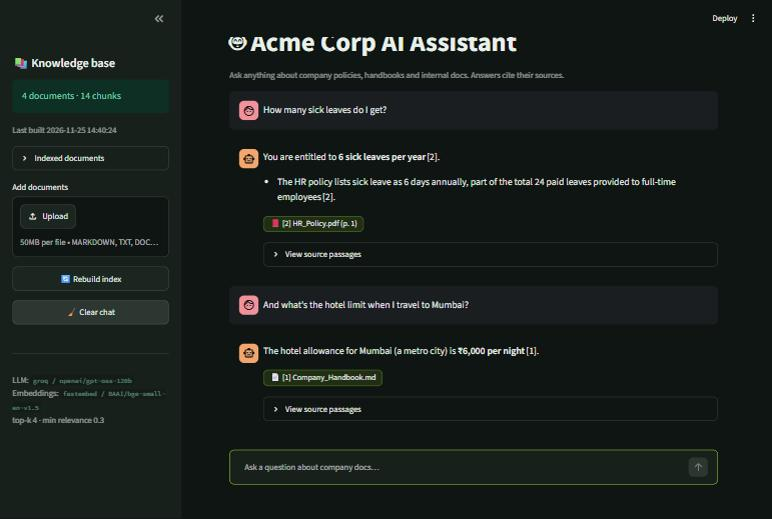

<div align="center">

# 🤖 RAG Company Docs Chatbot

**A private AI assistant that answers employee questions from internal company documents, with every answer cited to its source.**

### [🚀 Try the live demo →](https://rag-company-docs-chatbot.streamlit.app)

**[▶️ Watch the 45-second showcase](docs/showcase.mp4)** · **[📄 Read the full project report](docs/PROJECT_REPORT.md)** ([PDF](docs/PROJECT_REPORT.pdf))

[](https://rag-company-docs-chatbot.streamlit.app)
[](https://www.python.org/)
[](https://www.langchain.com/)
[](https://github.com/facebookresearch/faiss)
[](https://console.groq.com/)
[](https://streamlit.io/)
[](tests/test_rag.py)
[](LICENSE)

[Features](#-features) · [Architecture](#-architecture) · [Quick start](#-quick-start) · [Configuration](#%EF%B8%8F-configuration) · [Deployment](#-deployment) · [Roadmap](#-roadmap)



</div>

---

## 📌 Overview

Employees waste hours searching HR policies, handbooks and wikis spread across PDFs, Notion and Confluence.
This project is a **Retrieval-Augmented Generation (RAG)** assistant that indexes those documents and answers
questions in plain language. It quotes the exact document and page each fact came from, and says so when
the answer isn't in the documents.

It runs **entirely on free tiers**. The chat model is served by Groq's free API, and the embedding model runs
locally on CPU, so document contents are never sent to a third party for indexing.

```text
You:  How many sick leaves do I get?
Bot:  You are entitled to 6 sick leaves per year [2].     📕 [2] HR_Policy.pdf (p. 1)

You:  And what's the hotel limit when I travel to Mumbai?
Bot:  The hotel allowance for Mumbai (a metro city) is ₹6,000 per night [1].   📄 [1] Company_Handbook.md
```

## ✨ Features

| | Feature | Details |
|---|---|---|
| 📚 | **Multi-source ingestion** | PDF, DOCX, Markdown, TXT, a Notion workspace export, and Confluence spaces (optional) |
| 🔎 | **Semantic search** | FAISS vector index over overlapping, heading-aware chunks with normalised embeddings |
| 🧾 | **Cited answers** | Every claim carries an `[n]` citation linked to the file and page; only cited sources are shown |
| 🛑 | **Hallucination guard** | If no passage clears a relevance threshold, the bot refuses *without calling the LLM* |
| 💬 | **Conversational memory** | Follow-ups such as *"what about sick leave?"* are rewritten into standalone queries before retrieval |
| 🔌 | **Provider-agnostic** | Groq or OpenAI for chat; FastEmbed (local) or OpenAI for embeddings, switched in config |
| 🖥️ | **Three interfaces** | Streamlit chat app with document upload and re-indexing, a terminal chat, and a Python API |
| ✅ | **Measured quality** | Golden-set evaluation of retrieval hit-rate and answer accuracy, plus offline unit tests |
| ☁️ | **Deploy-ready** | Builds its index on first start; reads keys from Streamlit Secrets; fits the free cloud tier |

## 🏗 Architecture

```mermaid
flowchart TB
    subgraph ING["Ingestion - python ingest.py"]
        A["PDF, DOCX, MD, TXT"] --> L["Loaders with source and page metadata"]
        N["Notion export"] --> L
        C["Confluence - optional"] --> L
        L --> S["Recursive splitter: 800 chars, 120 overlap"]
        S --> E1["FastEmbed bge-small-en-v1.5, local CPU"]
        E1 --> V[("FAISS index and manifest")]
    end

    subgraph QRY["Query - app.py or cli.py"]
        Q["User question"] --> R["Condense follow-up into standalone query"]
        R --> E2["Embed query"]
        E2 --> V
        V --> K["Top-k passages above relevance threshold"]
        K -- "none pass" --> X["Refuse: not in documents"]
        K -- "passages found" --> P["Grounded prompt with numbered context"]
        P --> G["Groq LLM gpt-oss-120b"]
        G --> O["Streamed answer with cited sources"]
    end
```



**How a question is answered**

1. **Condense:** if there is chat history, the LLM rewrites the question so it makes sense on its own.
2. **Retrieve:** the question is embedded locally and FAISS returns the top-k most similar chunks.
3. **Filter:** chunks below `MIN_RELEVANCE` are dropped. If none remain, the bot answers "not found" without calling the LLM.
4. **Generate:** the remaining chunks are numbered and passed to the LLM with instructions to answer *only* from them and cite `[n]`.
5. **Attribute:** the UI shows only the sources the answer actually cited, each with file name, page and the passage text.

## 🧰 Tech stack

| Layer | Technology | Why |
|---|---|---|
| Orchestration | LangChain (core, community, text-splitters) | Standard loaders, splitters and vector-store interfaces |
| Vector store | FAISS (CPU) | Fast, file-based, no server to run |
| Embeddings | FastEmbed · `BAAI/bge-small-en-v1.5` | Free, runs on CPU via ONNX (no PyTorch), small enough for free hosting |
| LLM | Groq · `openai/gpt-oss-120b` | Free tier, very low latency; OpenAI-compatible fallback |
| UI | Streamlit | Chat components, streaming, file upload, one-click cloud deploy |
| Testing | pytest, LangChain fake embeddings and fake LLM | Deterministic tests with no API key or network |

## 🚀 Quick start

**Prerequisites:** Python 3.10+ and a free Groq API key from [console.groq.com/keys](https://console.groq.com/keys).

```bash
git clone https://github.com/arpit-k16/RAG-Company-Docs-Chatbot.git
cd RAG-Company-Docs-Chatbot

python -m venv .venv
# Windows:        .venv\Scripts\activate
# macOS / Linux:  source .venv/bin/activate

pip install -r requirements.txt
cp .env.example .env            # Windows: copy .env.example .env
# then open .env and set GROQ_API_KEY=gsk_...
```

```bash
pytest -q                        # offline tests, no key needed
python ingest.py                 # build the index (first run downloads the ~70 MB embedding model)
streamlit run app.py             # open http://localhost:8501
```

**Other entry points**

```bash
python cli.py                                     # chat in the terminal
python cli.py -q "How do I report a phishing email?"
python evaluate.py                                # retrieval + answer accuracy report
python evaluate.py --retrieval-only               # retrieval only, no LLM calls
```

**Use it from Python**

```python
from config import settings
from rag import RAGChatbot

bot = RAGChatbot.from_settings(settings)
answer = bot.ask("What is our leave policy?")
print(answer.text)
for s in answer.sources:
    print(s.number, s.label, s.score)
```

## ⚙️ Configuration

All settings are read from `.env` locally or from **Secrets** on Streamlit Cloud.

| Variable | Default | Description |
|---|---|---|
| `GROQ_API_KEY` | (required for Groq) | Free key from console.groq.com |
| `OPENAI_API_KEY` | (none) | Only needed if a provider is set to `openai` |
| `LLM_PROVIDER` | `groq` | `groq` or `openai` |
| `CHAT_MODEL` | `openai/gpt-oss-120b` | Any chat model your provider offers |
| `EMBEDDING_PROVIDER` | `fastembed` | `fastembed` (local, free) or `openai` |
| `EMBEDDING_MODEL` | `BAAI/bge-small-en-v1.5` | Changing it triggers an automatic re-index |
| `COMPANY_NAME` | `Acme Corp` | Shown in the UI and used in the system prompt |
| `CHUNK_SIZE` / `CHUNK_OVERLAP` | `800` / `120` | Characters per chunk and overlap between chunks |
| `TOP_K` | `4` | Passages retrieved per question |
| `MIN_RELEVANCE` | `0.3` | Below this score a passage is ignored; raise it for stricter answers |
| `TEMPERATURE` | `0` | LLM sampling temperature |
| `DOCS_DIR` / `NOTION_EXPORT_DIR` | `data/docs` / `data/notion` | Where documents are read from |
| `CONFLUENCE_URL`, `_USERNAME`, `_API_KEY`, `_SPACE_KEY` | (none) | Enables Confluence ingestion when all four are set |

### Using your own documents

- **Files:** drop PDF, DOCX, MD or TXT files into `data/docs/`, or upload them in the app sidebar, then click **Rebuild index**.
- **Notion:** in *Settings → Export*, choose *Markdown & CSV* and unzip the export into `data/notion/`. Notion's ID suffixes are stripped from titles automatically.
- **Confluence:** run `pip install atlassian-python-api beautifulsoup4`, set the four `CONFLUENCE_*` variables, then run `python ingest.py`.

## 🧪 Evaluation & testing

- **`evaluate.py`** runs a golden set of questions (`data/eval/golden_set.json`) and reports:
  - **Retrieval hit-rate:** did the expected document appear in the top-k results?
  - **Answer accuracy:** does the answer contain the expected facts?
  - **Refusal check:** for an out-of-scope question, does the bot correctly say it can't find the answer?
**Results** (`python evaluate.py`, gpt-oss-120b on Groq with bge-small-en-v1.5 embeddings, 11 questions):

| Metric | Score |
|---|---|
| Retrieval hit-rate (expected document in top-k) | **100%** (11/11) |
| Answer accuracy (expected facts present) | **100%** (11/11) |
| Out-of-scope refusal ("What is the company's stock ticker?") | ✅ Refused correctly |
| End-to-end time for the full set | ~18 s (≈1.6 s per question) |

> An early run scored 10/11 because the model wrote "3 months" with a Unicode narrow no-break space.
> The grader now normalises Unicode and Markdown before matching, so formatting differences don't count as wrong answers.

- **`tests/test_rag.py`** covers loaders and metadata, chunking, index build/save/load, embedding-model mismatch detection, the no-context refusal path and follow-up condensing. It uses fake embeddings and a fake LLM, so it runs offline in seconds.

## ☁️ Deployment

**Live:** [rag-company-docs-chatbot.streamlit.app](https://rag-company-docs-chatbot.streamlit.app), running on Streamlit Community Cloud's free tier.

To deploy your own copy:

1. Fork or push this repo to your GitHub account.
2. Go to [share.streamlit.io](https://share.streamlit.io), click **Create app**, select the repo and `app.py`, and choose Python 3.12 under *Advanced settings* (newer versions may lack wheels for FAISS / ONNX Runtime).
3. Add your key under **Secrets**:
   ```toml
   GROQ_API_KEY = "gsk_..."
   ```
4. Click **Deploy**. On first start the app downloads the embedding model and indexes `data/docs/` automatically, which takes about a minute.

> `.env`, `storage/` and `.streamlit/secrets.toml` are git-ignored, so keys and generated indexes never reach the repository.

## 📁 Project structure

```text
RAG-Company-Docs-Chatbot/
├── app.py                  # Streamlit chat UI: upload docs, rebuild index, streamed answers with sources
├── cli.py                  # Terminal chat / single-question mode
├── ingest.py               # Load → chunk → embed → save FAISS index
├── evaluate.py             # Golden-set evaluation
├── config.py               # Typed settings from .env / Streamlit secrets
├── rag/
│   ├── loaders.py          # PDF, DOCX, MD/TXT, Notion export, Confluence
│   ├── index.py            # Chunking, FAISS build/load, manifest + embedding-model check
│   ├── providers.py        # Groq/OpenAI chat models, FastEmbed/OpenAI embeddings
│   └── chatbot.py          # Retrieval, prompt, citations, streaming, conversation memory
├── data/
│   ├── docs/               # Sample company docs (HR policy PDF, handbook, IT security policy)
│   ├── notion/             # Sample Notion export
│   └── eval/               # Golden Q&A set
├── tests/test_rag.py       # Offline unit tests
├── docs/
│   ├── PROJECT_REPORT.md   # Full project report (also as PDF)
│   ├── showcase.mp4        # 45-second showcase video
│   └── images/             # Slides and screenshots
└── .streamlit/             # Theme + secrets template
```

## 🧠 Design decisions

- **Refuse instead of guess.** The relevance threshold is checked *before* the LLM is called. Out-of-scope questions get an honest "not found" at zero cost, which removes the most common source of hallucinations.
- **Normalised vectors.** FAISS stores L2-normalised embeddings, so distances map cleanly to a 0–1 relevance score for any embedding model.
- **Index integrity.** The index manifest records which embedding model built it. Loading with a different model raises a clear "rebuild" error, and the app re-indexes automatically.
- **Local embeddings.** Document text is embedded on your own machine; only the few retrieved passages are sent to the LLM.
- **Citation hygiene.** Model output is normalised (some models write `【1】` instead of `[1]`), and the UI lists only the sources an answer actually cites.

## 🛠 Troubleshooting

| Symptom | Fix |
|---|---|
| `Could not load model ... from any source` with a `401` error | An expired Hugging Face login on your machine. The app already ignores saved logins for public models; you can also run `hf auth logout`. |
| `model_not_found` from Groq | The model isn't enabled for your account. Set `CHAT_MODEL` in `.env` to one listed at [console.groq.com/docs/models](https://console.groq.com/docs/models). |
| `429` / rate-limit message | You hit the Groq free-tier limit. Wait a minute, or use a smaller model such as `llama-3.1-8b-instant`. |
| "The index was built with ..." error | You changed the embedding model. Run `python ingest.py`, or click **Rebuild index**. |

## 🗺 Roadmap

- [ ] Hybrid search (BM25 + vectors) with a cross-encoder re-ranker
- [ ] Role-based access: filter retrieval by department metadata
- [ ] Incremental ingestion keyed on file hashes
- [ ] FastAPI endpoint and a Slack / Microsoft Teams bot
- [ ] Answer feedback (👍/👎) logged for continuous evaluation

## 📄 License

Released under the [MIT License](LICENSE).

## 👤 Author

**Arpit Kumar** · [GitHub @arpit-k16](https://github.com/arpit-k16)

If you found this useful, consider giving the repo a ⭐
