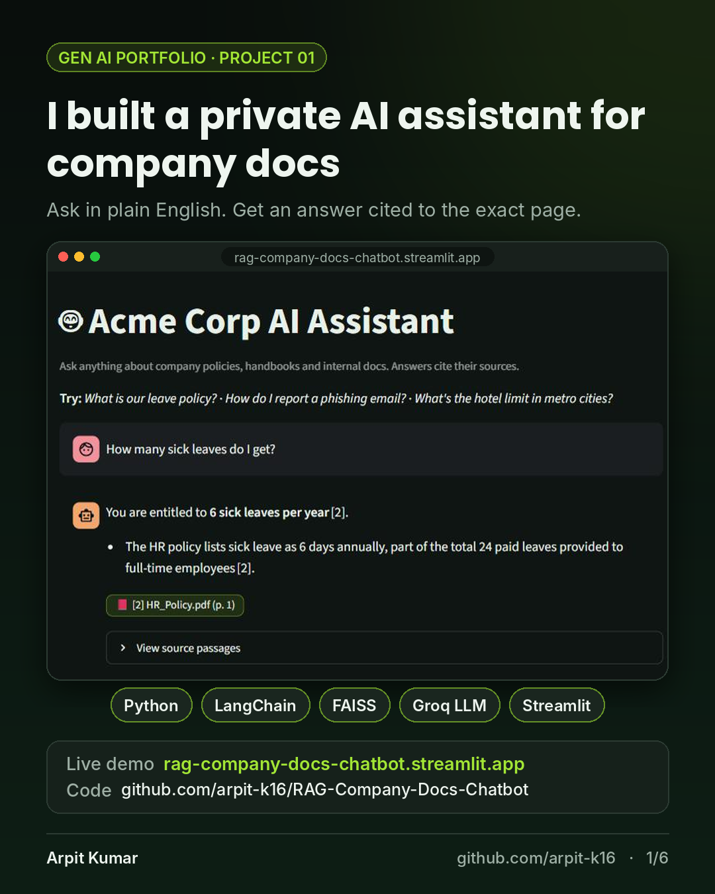
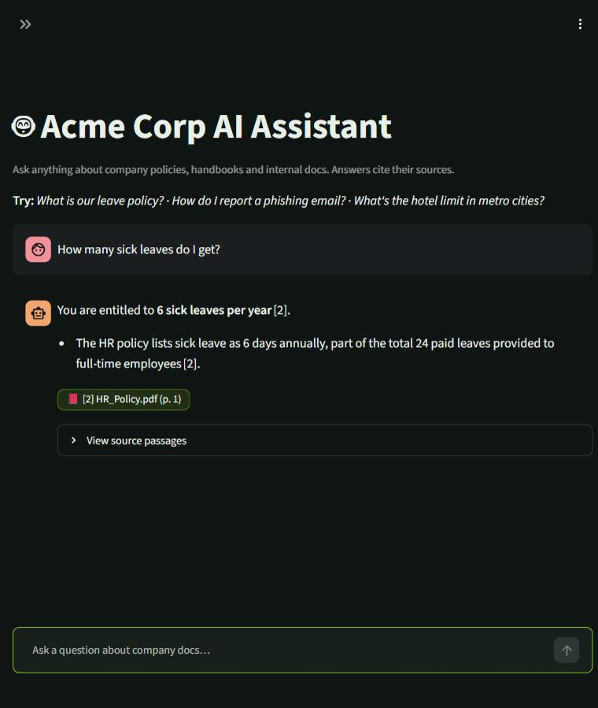
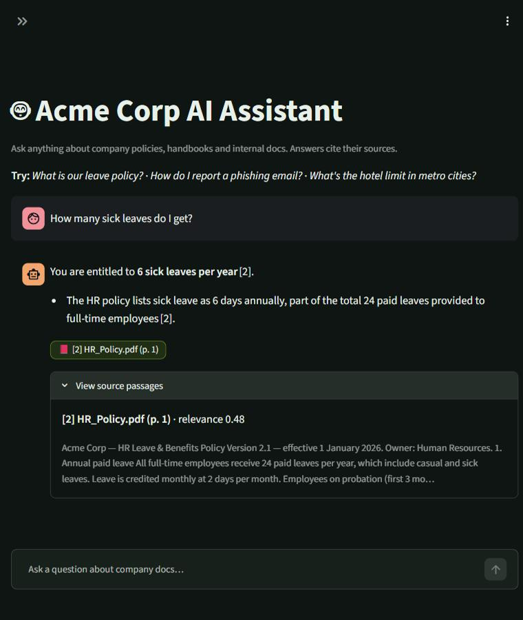
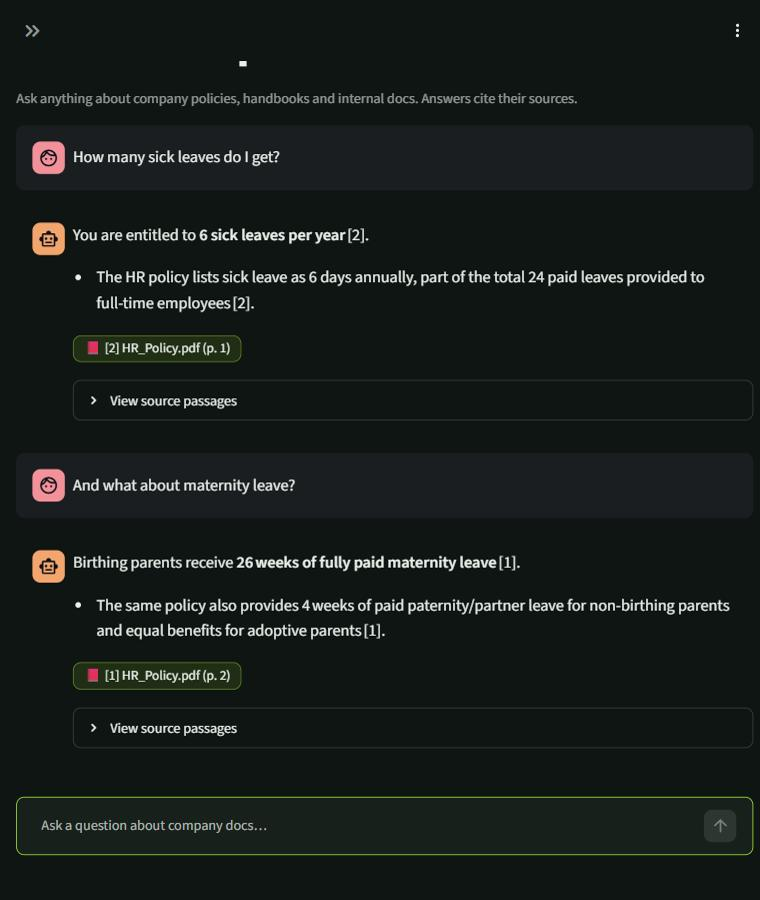
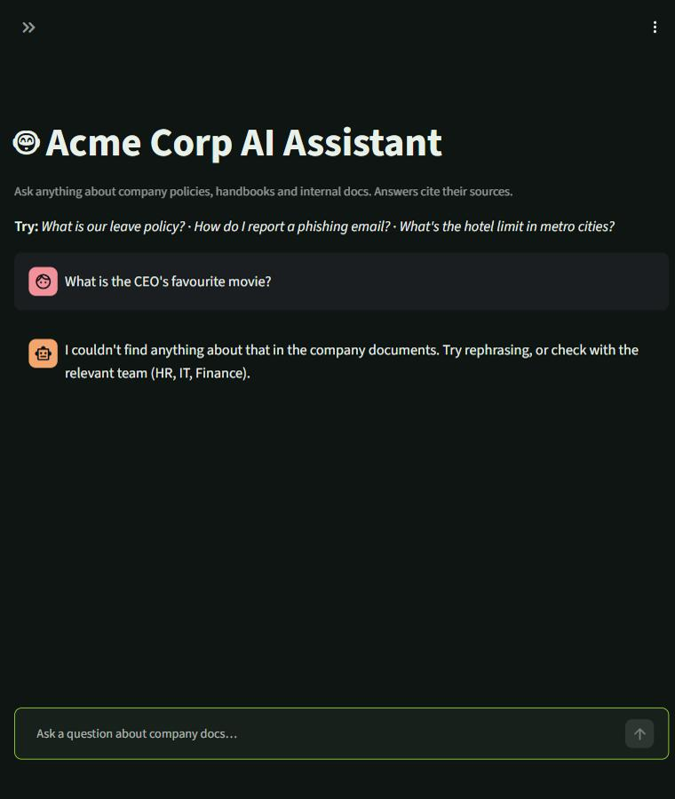
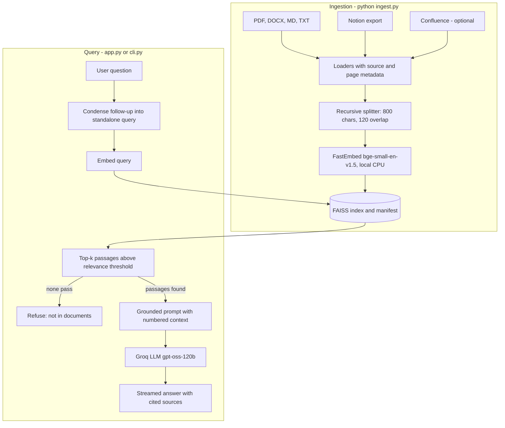
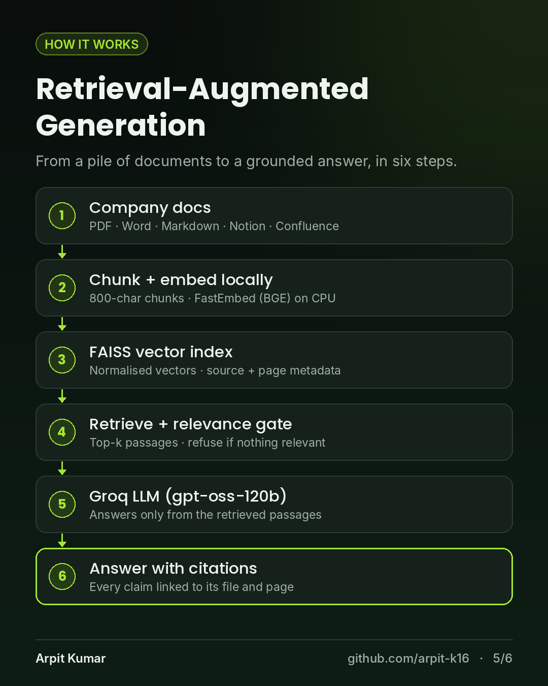
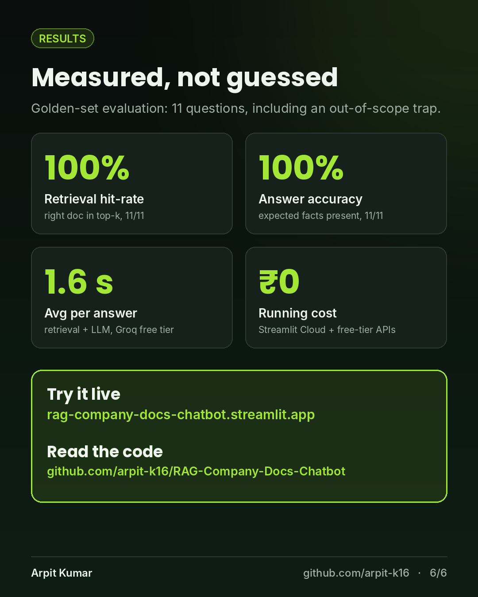

# RAG Company Docs Chatbot: Project Report

**Author:** Arpit Kumar ([@arpit-k16](https://github.com/arpit-k16))
**Project:** Gen AI Portfolio, Project 1 of 6
**Date:** November 2026
**Live demo:** <https://rag-company-docs-chatbot.streamlit.app>
**Source code:** <https://github.com/arpit-k16/RAG-Company-Docs-Chatbot>
**Showcase video:** [`docs/showcase.mp4`](showcase.mp4) (45 s)

---

## Table of contents

1. [Executive summary](#1-executive-summary)
2. [Problem statement](#2-problem-statement)
3. [Objectives and scope](#3-objectives-and-scope)
4. [Solution overview](#4-solution-overview)
5. [System architecture](#5-system-architecture)
6. [Component deep-dive](#6-component-deep-dive)
7. [Technology choices](#7-technology-choices)
8. [Dataset](#8-dataset)
9. [Evaluation](#9-evaluation)
10. [Testing](#10-testing)
11. [Deployment](#11-deployment)
12. [Engineering challenges and how they were solved](#12-engineering-challenges-and-how-they-were-solved)
13. [Security and privacy](#13-security-and-privacy)
14. [Limitations](#14-limitations)
15. [Future work](#15-future-work)
16. [Showcase assets](#16-showcase-assets)
17. [Appendix](#17-appendix)

---

## 1. Executive summary

This project is a **Retrieval-Augmented Generation (RAG)** assistant that answers employee questions from a
company's internal documents (HR policies, handbooks, IT policies, wiki pages) and cites the exact file and
page behind every answer. When the documents do not contain the answer, it says so instead of guessing.

| | |
|---|---|
| **What it does** | Answers natural-language questions over PDF, DOCX, Markdown, Notion exports and Confluence, with citations |
| **Key safeguard** | A relevance gate: if no retrieved passage is relevant enough, the LLM is never called |
| **Results** | 100% retrieval hit-rate and 100% answer accuracy on an 11-question golden set; ~1.6 s average per answer |
| **Cost** | ₹0. Groq free tier for the LLM, local CPU embeddings, Streamlit Community Cloud hosting |
| **Status** | Deployed and publicly accessible |



---

## 2. Problem statement

Knowledge inside organisations is fragmented. Policies live in PDFs on shared drives, onboarding guides in
Notion, IT rules in Confluence, and expense rules in Word files that were last edited months ago. Employees
either search several tools or ask colleagues, which interrupts other people's work and sometimes produces
outdated or wrong answers.

The McKinsey Global Institute's report *The Social Economy* (July 2012) estimates that knowledge workers spend
about **19% of their working hours tracking down information** they need to do their jobs, which is close to
one full day per week.

**The core question:** can employees get a correct, verifiable answer to a policy question in seconds,
without a human in the loop and without the AI inventing policies that do not exist?

---

## 3. Objectives and scope

**Functional objectives**

1. Ingest documents from common enterprise sources: PDF, DOCX, Markdown/TXT, a Notion export, Confluence.
2. Answer questions in plain language, grounded only in those documents.
3. Cite every claim with the source file and page, and let users inspect the source passage.
4. Support follow-up questions in a conversation.
5. Refuse clearly when the answer is not in the documents.

**Non-functional objectives**

- Run entirely on free tiers so the demo can stay online indefinitely.
- Keep document embeddings local (no third-party embedding API).
- Be measurable: ship with an evaluation set and offline unit tests.
- Be easy to switch between providers (Groq / OpenAI) without code changes.

**Out of scope (for this version)**

- Per-user access control on documents.
- Very large corpora (millions of chunks), which would need a managed vector database.
- Scanned PDFs without a text layer (no OCR).

---

## 4. Solution overview

The user opens a Streamlit chat app, asks a question, and receives a streamed answer with numbered citations.
Under each answer, chips show the cited files and pages, and an expander reveals the exact passage text and its
relevance score.

| Ask and get a cited answer | Inspect the exact source passage |
|---|---|
|  |  |

| Follow-up questions understood from context | Honest refusal for out-of-scope questions |
|---|---|
|  |  |

The sidebar shows the knowledge base status (documents and chunk count), lets users upload new files, and
rebuilds the index with one click.

---

## 5. System architecture

The system has two pipelines: **ingestion** (offline, run once per document change) and **query** (online,
per question).





---

## 6. Component deep-dive

### 6.1 Document loading (`rag/loaders.py`)

| Source | Loader | Metadata added |
|---|---|---|
| PDF | LangChain `PyPDFLoader` (one document per page) | `source`, `page` (converted to 1-based), `source_type=pdf` |
| DOCX | `Docx2txtLoader` | `source`, `source_type=docx` |
| Markdown / TXT | Read directly | `source`, `source_type` |
| Notion export | Same as Markdown, then Notion's 32-character ID suffix is stripped from titles | `source_type=notion` |
| Confluence | LangChain `ConfluenceLoader` (optional, enabled by four env vars) | `source` = page title, `url` = page link |

A single unreadable file is logged and skipped rather than stopping ingestion. Office lock files (`~$...`) and
hidden files are ignored.

### 6.2 Chunking (`rag/index.py`)

- `RecursiveCharacterTextSplitter`, **800 characters with 120 overlap**.
- Separators prefer Markdown headings (`## `, `### `), then paragraphs, lines and sentences, so chunks
  follow the document's structure.
- Every chunk gets a stable `chunk_id`: a hash of path, page and start offset.

### 6.3 Embeddings

- **FastEmbed** running `BAAI/bge-small-en-v1.5` (384 dimensions) through ONNX Runtime on CPU.
- No PyTorch dependency, which keeps the deployed app small enough for free hosting.
- The model is downloaded once (~70 MB) and cached in `storage/models/`.

### 6.4 Vector store

- **FAISS** with **L2-normalised vectors**, so distances map onto a 0–1 relevance score regardless of the
  embedding model.
- The index is saved to disk with a `manifest.json` recording build time, chunk count, sources and the
  **embedding model signature**. Loading an index with a different embedding model raises a clear "rebuild"
  error, and the app re-indexes automatically.

### 6.5 Retrieval and the relevance gate (`rag/chatbot.py`)

1. Retrieve the top-k (default 4) chunks with relevance scores.
2. Drop chunks below `MIN_RELEVANCE` (default 0.3).
3. If nothing remains, return a fixed "I couldn't find that in the company documents" message **without calling
   the LLM**. This removes the most common hallucination path (answering from general knowledge) and costs nothing.

### 6.6 Conversational memory

When there is chat history, the LLM first rewrites the latest question into a standalone query (for example,
*"And what about maternity leave?"* becomes *"How long is maternity leave?"*). Retrieval uses the rewritten
query; the final answer still sees the recent conversation (last 6 turns).

### 6.7 Prompt design

The system prompt instructs the model to:

- answer **only** from the numbered context passages;
- cite passages inline as `[1]`, `[2][3]`, with a citation on every factual sentence;
- say it could not find the answer, and suggest which team to ask, when the context lacks it;
- prefer the most recent version when passages conflict, and mention the conflict;
- be concise: direct answer first, then supporting detail.

The full prompt is in the [appendix](#172-system-prompt).

### 6.8 Citation handling

- Model output is normalised: some models emit `【1】` instead of `[1]`, so these are converted.
- The UI shows **only the sources the answer actually cites**. An answer that cites nothing (for example, a
  refusal) shows no source chips.

### 6.9 Provider abstraction (`rag/providers.py`)

| Setting | Options |
|---|---|
| `LLM_PROVIDER` | `groq` (default), `openai` |
| `EMBEDDING_PROVIDER` | `fastembed` (default, local), `openai` |

Switching providers is a one-line change in `.env`, with no code changes.

### 6.10 Interfaces

- **Streamlit app (`app.py`):** chat with streaming, citation chips, source-passage expander, document upload,
  one-click re-indexing, automatic first-run indexing, friendly rate-limit messages.
- **CLI (`cli.py`):** an interactive terminal chat, or a single question with `-q`.
- **Python API:** `RAGChatbot.from_settings(settings).ask("...")` returns the answer text plus structured sources.

---

## 7. Technology choices

| Layer | Choice | Why | Alternatives considered |
|---|---|---|---|
| Orchestration | LangChain (core, community, text-splitters) | Mature loaders and splitters, standard vector-store API | LlamaIndex |
| Vector store | FAISS (CPU) | Fast, file-based, no server | Chroma, Qdrant, pgvector |
| Embeddings | FastEmbed + bge-small-en-v1.5 | Free, local, small; ONNX instead of PyTorch | OpenAI text-embedding-3-small, sentence-transformers |
| LLM | Groq, `openai/gpt-oss-120b` | Free tier, very low latency, strong instruction following | OpenAI gpt-4o-mini, Llama 3.x |
| UI | Streamlit | Chat components, streaming, free one-click hosting | Gradio, FastAPI + React |
| Hosting | Streamlit Community Cloud | Free, deploys straight from GitHub | Hugging Face Spaces (free compute now requires a paid plan), Render |
| Testing | pytest + LangChain fake embeddings and fake LLM | Deterministic, offline, no API key | Recorded API fixtures |

---

## 8. Dataset

The demo ships with a small synthetic corpus for a fictional company, **Acme Corp**:

| Document | Type | Content |
|---|---|---|
| `HR_Policy.pdf` | PDF, 2 pages | Leave & benefits policy v2.1: 24 paid leaves, leave types, carry-forward, parental leave, holidays, insurance |
| `Company_Handbook.md` | Markdown | Working hours, hybrid work, payroll, reviews, learning budget, travel & expenses, contacts |
| `IT_Security_Policy.md` | Markdown | Passwords & MFA, devices, phishing reporting, data classification, AI tool usage, VPN |
| `Engineering Onboarding` | Notion export | Week-1 checklist, engineering practices, on-call rotation |

After chunking, the index holds **14 chunks** from **4 documents**. All company names, figures and
policies are fictional.

---

## 9. Evaluation

### 9.1 Method

`evaluate.py` runs a golden set of 11 questions (`data/eval/golden_set.json`) through the full pipeline and checks:

- **Retrieval hit-rate:** does the expected source document appear in the top-k retrieved chunks?
- **Answer accuracy:** does the answer contain the expected facts (keyword match after normalisation)?
- **Refusal:** for an out-of-scope question, does the bot say it cannot find the answer?

Before matching, text is normalised (Unicode NFKC, curly apostrophes, Markdown bold removed, lower-cased), so
formatting differences are not counted as wrong answers.

### 9.2 Results

Configuration: Groq `openai/gpt-oss-120b`, FastEmbed `bge-small-en-v1.5`, top-k 4, min relevance 0.3.

| # | Question | Expected source | Retrieved (top 3) | Expected fact | Result |
|---|---|---|---|---|---|
| 1 | What is our leave policy? | HR_Policy.pdf | HR_Policy ×3 | 24 | ✅ |
| 2 | How many sick leaves do I get? | HR_Policy.pdf | HR_Policy ×3 | 6 | ✅ |
| 3 | How many earned leaves can I carry forward? | HR_Policy.pdf | HR_Policy ×3 | 10 | ✅ |
| 4 | How long is maternity leave? | HR_Policy.pdf | HR_Policy ×3 | 26 weeks | ✅ |
| 5 | How do I report a phishing email? | IT_Security_Policy.md | IT_Security ×3 | "Report Phishing" | ✅ |
| 6 | What is the minimum password length? | IT_Security_Policy.md | IT_Security ×3 | 14 | ✅ |
| 7 | How much is the yearly learning budget? | Company_Handbook.md | Handbook, HR, Handbook | ₹40,000 | ✅ |
| 8 | What is the hotel limit in metro cities? | Company_Handbook.md | Handbook ×2, IT_Security | ₹6,000 | ✅ |
| 9 | How many days a week do I need to be in the office? | Company_Handbook.md | Handbook, Onboarding, HR | 2 | ✅ |
| 10 | When do engineers join the on-call rotation? | Engineering Onboarding | Onboarding ×2, Handbook | 3 months | ✅ |
| 11 | What is the company's stock ticker symbol? | (out of scope) | (none above threshold) | refusal | ✅ |

| Metric | Score |
|---|---|
| Retrieval hit-rate | **100%** (11/11) |
| Answer accuracy | **100%** (11/11) |
| Out-of-scope refusal | ✅ |
| Total time for 11 questions | 18.0 s (≈ **1.6 s per question**, retrieval + LLM) |

> **Note on the first run:** the first evaluation scored 10/11. The failing case (#10) answered correctly
> ("after 3 months"), but the model wrote the space as a Unicode narrow no-break space (U+202F), so a plain
> substring check for "3 months" failed. The grader was fixed to normalise Unicode before matching.



### 9.3 Caveats

- 11 questions is a small, hand-written set over a small corpus. It verifies the pipeline end to end, but it is
  not a benchmark. A larger set with paraphrased and multi-hop questions would give a more robust estimate.
- Keyword matching checks that the key facts are present, not the full quality of the answer.

---

## 10. Testing

`tests/test_rag.py` runs offline in seconds using LangChain's `DeterministicFakeEmbedding` and `FakeListChatModel`:

| Test | What it verifies |
|---|---|
| `test_loaders_attach_metadata` | All sample files load; PDF pages are 1-based; content is present |
| `test_notion_id_suffix_is_stripped` | Notion export titles are cleaned |
| `test_chunking_keeps_metadata_and_ids` | Chunk size limit, metadata kept, unique chunk IDs |
| `test_build_save_load_and_answer` | Index build, save, manifest, load, and answer with numbered sources |
| `test_no_relevant_context_skips_llm` | Relevance gate returns the refusal without calling the LLM |
| `test_follow_up_question_is_condensed` | Follow-ups are rewritten before retrieval |
| `test_embedding_model_mismatch_is_detected` | Loading an index with a different embedding model fails clearly |
| `test_provider_key_check` | Missing API key detection per provider |
| `test_missing_index_has_helpful_error` | Clear error when the index has not been built |

Manual end-to-end tests were also run in the browser, locally and on the deployed app: leave policy,
phishing, a follow-up about hotel limits in Mumbai and maternity leave, and out-of-scope questions.

---

## 11. Deployment

| Item | Value |
|---|---|
| Platform | Streamlit Community Cloud (free tier) |
| URL | <https://rag-company-docs-chatbot.streamlit.app> |
| Python | 3.12 (3.14 is the platform default but lacks wheels for some dependencies) |
| Secrets | `GROQ_API_KEY` in the app's Secrets (TOML); copied into environment variables at start-up |
| First start | Downloads the embedding model and builds the index from `data/docs/` automatically |
| Sleep behaviour | The app sleeps after inactivity; the next visitor wakes it in about 30 s |

Steps to reproduce: push the repo to GitHub, create an app on share.streamlit.io pointing to `app.py`, choose
Python 3.12, add the key under Secrets, and deploy.

---

## 12. Engineering challenges and how they were solved

| # | Symptom | Root cause | Fix |
|---|---|---|---|
| 1 | `Could not load model BAAI/bge-small-en-v1.5 from any source`, HTTP 401 | An **expired Hugging Face login** saved on the development machine was sent with every download, even though the model is public | Set `HF_HUB_DISABLE_IMPLICIT_TOKEN=1` in `config.py`, before `huggingface_hub` is imported, so public downloads never send a saved token |
| 2 | Groq `model_not_found` for `llama-3.3-70b-versatile` even after changing the default | The model was not available to the account, **and** a system-wide `CHAT_MODEL` environment variable was overriding the project setting | Switched the default to `openai/gpt-oss-120b` and loaded `.env` with `override=True`, so project settings win over machine-wide variables |
| 3 | Citations appeared as `【1】` and source chips disappeared | gpt-oss sometimes emits CJK lenticular brackets instead of `[1]` | Normalise `【】` to `[]` in both streaming and non-streaming paths, and ask for "plain square brackets" in the prompt |
| 4 | Refusals still showed source chips | The UI listed every retrieved passage, not only the cited ones | Parse `[n]` citations from the answer and show only those sources |
| 5 | Evaluation scored 10/11 on a correct answer | U+202F narrow no-break space in "3 months" | Unicode NFKC normalisation in the grader |
| 6 | Deploy risk on Streamlit Cloud | Default Python 3.14 lacks wheels for FAISS / ONNX Runtime | Pinned the app to Python 3.12 in deployment settings and documented it |
| 7 | Architecture diagram failed to render on GitHub | Special characters (`·`, `≥`, `+` after line breaks) in Mermaid labels | Simplified the labels and switched to a top-down layout for readability |

---

## 13. Security and privacy

- **API keys** live in `.env` locally and in Streamlit Secrets in production. `.env`, `storage/` and
  `.streamlit/secrets.toml` are git-ignored, and the repository was checked for key patterns before each push.
- **Local embeddings:** document text is embedded on the server itself. Only the few retrieved passages for a
  question are sent to the LLM provider.
- **Index deserialisation:** FAISS's docstore is pickled, so loading it uses `allow_dangerous_deserialization=True`.
  This is safe here because the index is only ever written by this app's own ingestion step. Never load an index
  from an untrusted source.
- **Uploads:** uploaded file names are reduced to their base name before saving, which prevents path traversal.
- **Public demo:** the deployed app contains only fictional sample data. A real company deployment should add
  authentication (for example, SSO in front of the app) and per-document access control.

---

## 14. Limitations

- No OCR: scanned PDFs without a text layer are not readable.
- Fixed-size chunking can split tables; table-aware parsing would improve answers about tabular data.
- Pure vector search can miss exact identifiers (policy codes, product SKUs); hybrid search would help.
- The free LLM tier has request and token limits, so heavy traffic will hit rate limits (handled with a friendly message).
- The evaluation set is small (see 9.3).
- The FAISS index is rebuilt from scratch on changes. Fine for hundreds of documents, but not for very large corpora.

---

## 15. Future work

1. **Hybrid retrieval:** BM25 plus vectors, with a cross-encoder re-ranker.
2. **Access control:** filter retrieval by user role or department metadata.
3. **Incremental ingestion:** re-embed only changed files, keyed on file hashes.
4. **Larger evaluation:** 100+ questions, including paraphrases, multi-hop and adversarial prompts; track faithfulness with an LLM judge.
5. **Integrations:** a FastAPI endpoint, plus Slack / Microsoft Teams bots.
6. **Feedback loop:** 👍/👎 on answers, logged for continuous evaluation.
7. **OCR and table parsing** for scanned and table-heavy documents.

---

## 16. Showcase assets

| Asset | Description |
|---|---|
| [`docs/showcase.mp4`](showcase.mp4) | 45-second video: Problem → Solution → Under the hood → Impact → End, with an original background track |
| [`docs/images/`](images/) | 6 LinkedIn carousel slides (1080×1350) and app screenshots used in this report |
| [`docs/demo.jpg`](demo.jpg) | README screenshot |

All visuals are built from real screenshots of the running application.

---

## 17. Appendix

### 17.1 Configuration reference

| Variable | Default | Description |
|---|---|---|
| `GROQ_API_KEY` | (required for Groq) | Free key from console.groq.com |
| `OPENAI_API_KEY` | (none) | Only if a provider is set to `openai` |
| `LLM_PROVIDER` | `groq` | `groq` or `openai` |
| `CHAT_MODEL` | `openai/gpt-oss-120b` | Chat model name |
| `EMBEDDING_PROVIDER` | `fastembed` | `fastembed` or `openai` |
| `EMBEDDING_MODEL` | `BAAI/bge-small-en-v1.5` | Embedding model name |
| `COMPANY_NAME` | `Acme Corp` | Shown in the UI and the system prompt |
| `CHUNK_SIZE` / `CHUNK_OVERLAP` | `800` / `120` | Chunking parameters (characters) |
| `TOP_K` | `4` | Passages retrieved per question |
| `MIN_RELEVANCE` | `0.3` | Relevance gate threshold |
| `TEMPERATURE` | `0` | LLM temperature |
| `DOCS_DIR`, `NOTION_EXPORT_DIR`, `INDEX_DIR`, `MODEL_CACHE_DIR` | under `data/` and `storage/` | Paths |
| `CONFLUENCE_URL`, `_USERNAME`, `_API_KEY`, `_SPACE_KEY` | (none) | Enable Confluence ingestion |

### 17.2 System prompt

```text
You are the internal knowledge assistant for {company}.
Answer employee questions using ONLY the numbered context passages provided.

Rules:
- Cite the passages you used inline with plain square brackets, like [1] or [2][3]. Every factual sentence needs a citation.
- If the context does not contain the answer, say you could not find it in the company documents
  and suggest which team (HR, IT, Finance, ...) to ask. Never invent policies, numbers or dates.
- If passages conflict, prefer the most recent version and mention the conflict.
- Be concise: a direct answer first, then short supporting detail or bullet points if useful.
```

### 17.3 Repository structure

```text
RAG-Company-Docs-Chatbot/
├── app.py                  # Streamlit chat UI
├── cli.py                  # Terminal chat
├── ingest.py               # Build the FAISS index
├── evaluate.py             # Golden-set evaluation
├── config.py               # Settings from .env / Streamlit secrets
├── rag/
│   ├── loaders.py          # PDF, DOCX, MD/TXT, Notion, Confluence
│   ├── index.py            # Chunking, FAISS build/load, manifest
│   ├── providers.py        # Groq/OpenAI chat, FastEmbed/OpenAI embeddings
│   └── chatbot.py          # Retrieval, relevance gate, prompt, citations, memory
├── data/                   # Sample docs, Notion export, golden set
├── tests/test_rag.py       # Offline unit tests
└── docs/                   # This report, showcase video, images
```

### 17.4 How to run locally

```bash
git clone https://github.com/arpit-k16/RAG-Company-Docs-Chatbot.git
cd RAG-Company-Docs-Chatbot
python -m venv .venv && source .venv/bin/activate   # Windows: .venv\Scripts\activate
pip install -r requirements.txt
cp .env.example .env                                # add GROQ_API_KEY
pytest -q
python ingest.py
streamlit run app.py
```
